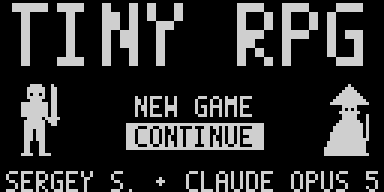
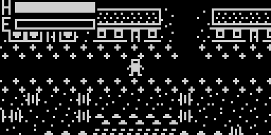

> **The code of this project was entirely generated by AI** (Claude Opus 5 by Anthropic).

# Tiny RPG

A small open-world action RPG in 16 KB of flash, for the
[CH32V003 RISC-V Mini Game Console by Stefan Wagner (wagiminator)](https://github.com/wagiminator/CH32V003-GameConsole).
It runs on the console's CH32V003J4M6 microcontroller (16 KB flash, 2 KB RAM) with its
128x64 OLED, analog joystick, ACT button and buzzer.

The game is inspired by the **Dark Souls** series, **Elden Ring**, **Ragnarok Online**
and **Dota 2**. Death is final and the bosses are hard, you level up and spend stat
points, and the gear and boss names nod to the games that inspired them.

- Two classes: a **warrior** with a sword and a **mage** whose staff fires bolts
- Six hand-drawn zones: a meadow with a town, a desert, a snowfield, Valhalla and two boss caves
- Nine kinds of monster and three bosses, with loot drops
- Stats, equipment, a 12-slot bag, timed scrolls and a shop that buys and sells
- Levels up to 100
- **Permadeath**: if you die, your save is erased




## Goal

Defeat **Malenia**, who waits at the far end of Valhalla, north of the snowfield.
She is by far the strongest creature in the world. Two other bosses guard caves in the
desert and the snowfield. They are optional, but the gear they drop makes the road to
Malenia a lot shorter.

## Installation

You need the console itself (see the
[console project](https://github.com/wagiminator/CH32V003-GameConsole) for the PCB,
parts and assembly) and a **WCH-LinkE** programmer. Wiring and how to put the
WCH-LinkE into RISC-V mode are described in the console project's README.

Flashing replaces whatever game is on the console.

### Upload the ready-made firmware

The precompiled firmware is in `bin/`: `tiny_rpg.bin` and `tiny_rpg.hex`.

1. Switch the console off or remove the battery.
2. Connect the WCH-LinkE to the console's programming header (DIO, GND, VCC).
3. Upload with [rvprog](https://pypi.org/project/rvprog/):
   ```
   pip install rvprog
   rvprog -f bin/tiny_rpg.bin
   ```
   Or, on Windows, open `bin/tiny_rpg.hex` in WCH-LinkUtility (mode "WCH-LinkRV") and upload it.

### Build from source

**You need WCH's own compiler.** The game is built with WCH's RISC-V GCC 15
(`riscv32-wch-elf`), which ships with [MounRiver Studio 2](http://www.mounriver.com/).
A stock RISC-V GCC will not do. The build uses `-march=rv32ecxw`, which turns on
**XW**, WCH's custom extension to the QingKe V2A core in the CH32V003. XW adds extra
16-bit compressed instructions for byte and halfword loads and stores, and this
improves code density. Without them the same code is 732 bytes too big for the 16 KB
of flash.

Put the WCH toolchain's `bin` folder on your `PATH`, then:

```
make all      # build bin/tiny_rpg.bin and .hex
make flash    # build and upload with rvprog
```

The image fills 16316 of the 16320 bytes available (the last 64-byte page holds the
save), so a different compiler or different flags may not fit.

The art and maps are generated, so don't edit the generated headers by hand:

```
python3 tools/gentiles.py   # -> src/worldtiles.h  (tiles, hero and monster sprites)
python3 tools/genui.py      # -> src/ui_art.h      (font, title banner, item icons)
python3 tools/mapconv.py map/world.txt map/desert.txt map/snow.txt \
        map/valhalla.txt map/sandcave.txt map/icecave.txt src/worldmap.h
```

## Controls

| Input | Action |
|---|---|
| Joystick | Walk |
| Tap **ACT** | Attack: a sword swing, or a bolt from a staff |
| Hold **ACT** | Open the character screen |
| Walk into a door | Enter or leave a cave |
| Walk into the shop counter | Trade with the merchant in town |

**Character screen.** Move between rows with up and down. On a stat, right spends a
point and left takes it back. You can take back only the points spent during this
visit to the screen. **INVENTORY** opens the paperdoll and the bag. Select an item and
press ACT to use, equip or drop it. **SAVE AND EXIT** saves the game and returns you to
the world. It is the only way to save.

## Stats

You start with 3 free points and earn 1 more each level.

| Stat | What it does |
|---|---|
| **STR** (strength) | Warrior's damage. Warriors fight with swords |
| **VIT** (vitality) | Maximum health |
| **INT** (intelligence) | Mage's damage. Mages fight with staffs |
| **AGI** (agility) | Walking speed for both classes, and how fast the warrior swings |
| **DEF** (defence) | Not a stat you can raise. It comes only from armour and a scroll, and it reduces the damage you take |

The **warrior** starts strong and tough but slow. The **mage** is fragile but hits from
a distance. Equipment adds to stats, and the character screen shows the bonus next to
each one.

Health slowly comes back on its own (a full bar takes about two minutes), and a level
up refills it.

## Items and the shop

- **Potions** and **elixirs** restore health.
- **Scrolls** boost AGI, DEF or INT for thirty seconds.
- An **Aegis** in your bag saves you from death once, then it is gone.
- Gear for the head, body, weapon hand and feet drops from monsters and bosses.
  Some of it can be bought in town.

The merchant sells gear, elixirs and scrolls for coins, which monsters drop. He also
buys anything back for a quarter of its value.

## Tips

- No monsters appear around the town, and nothing on the meadow attacks unless you hit it first.
- Some monsters come for you on sight, and some spit from a distance.
- Death is final. Save often, and keep an Aegis in the bag before a boss fight.

## Credits and license

- Console hardware and the low-level driver layer (`src/driver.h`, `src/system.*`,
  `src/gpio.h`, `src/i2c_tx.*`, `src/oled_min.*`, the linker script and the makefile
  this one is based on) by [Stefan Wagner](https://github.com/wagiminator).
  `src/ch32v003.h` is WCH's device header with his changes.
- The game's code and its tools were generated by Claude Opus 5.
- Some item and boss names are a fan nod to Dota 2 and Elden Ring. This is a fan
  project with no connection to the makers of Dark Souls, Elden Ring, Ragnarok Online
  or Dota 2.

Licensed under the GNU General Public License v3.0, see [LICENSE](LICENSE).
